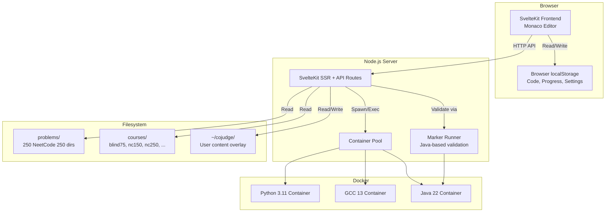
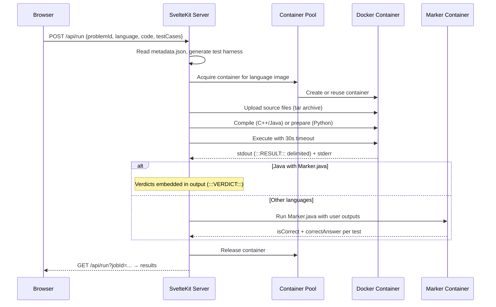

# DevPrep — Architecture

This document describes the current technical architecture of DevPrep, which is built on top of [Cojudge v0.8.8](https://github.com/cojudge/cojudge). It separates the existing implementation from approved future direction and proposed changes pending review.

For the detailed Phase 0 audit, see [docs/feasibility/architecture-audit.md](docs/feasibility/architecture-audit.md).

---

## Part 1 — Current Implementation

### System Overview



### Repository Structure

```
devprep/cojudge/
├── bin/                    # CLI entry point (`cojudge` command)
├── courses/                # Course definitions (courseinfo.json per course)
│   ├── basic50/
│   ├── blind75/
│   ├── nc150/
│   ├── nc250/
│   └── leetcode-1000/
├── docs/                   # Documentation
│   ├── feasibility/        # Phase 0 evaluation reports
│   ├── adr/                # Architecture decision records
│   └── templates/          # Report templates
├── docker/                 # Custom Docker image build files
├── e2e/                    # Playwright end-to-end tests
├── problems/               # 1031 problem directories (bundled content)
│   └── <slug>/
│       ├── metadata.json   # Function signature, starter code, test cases
│       ├── statement.md    # Problem description
│       ├── official-tests.json  # Hidden test cases
│       ├── Marker.java     # Reference solution + isCorrect validator
│       └── solution.md     # Solution walkthrough
├── scripts/                # Build and packaging scripts
├── src/                    # Application source
│   ├── lib/
│   │   ├── components/     # Svelte UI components
│   │   ├── runners/        # Language-specific Docker execution
│   │   ├── server/         # Server-only modules (content paths, cleanup)
│   │   ├── stores/         # Svelte stores (localStorage-backed)
│   │   └── utils/          # Language utilities, type conversion
│   └── routes/             # SvelteKit file-based routing
│       ├── api/            # Server API endpoints
│       ├── problems/[slug]/ # Problem view page
│       ├── playground/     # Code playground
│       └── ...
├── src-tauri/              # Tauri desktop app (not used by DevPrep v1.0)
├── static/                 # Static assets
├── ARCHITECTURE.md         # This file
├── CLAUDE.md               # Claude Code working instructions
├── PROJECT.md              # Project definition and requirements
├── TASKS.md                # Milestone tracker
├── package.json            # Node.js dependencies and scripts
├── Dockerfile              # Containerised deployment
└── docker.sh               # Docker deployment script
```

### Frontend

| Aspect | Implementation |
|---|---|
| Framework | SvelteKit 2.x with Svelte 5, Vite 7 |
| Adapter | `@sveltejs/adapter-node` (SSR with Node.js runtime) |
| Editor | Monaco Editor 0.54 with optional Vim mode |
| Styling | CSS with custom properties for light/dark theming |
| State | Svelte stores backed by browser `localStorage` |

**Pages:**

| Route | Purpose |
|---|---|
| `/` | Homepage: course listing, progress tracker, problem table |
| `/problems/[slug]` | Problem view: statement, editor, test runner, debugger |
| `/playground` | Free-form code execution |
| `/whiteboard` | Drawing whiteboard |
| `/recovery` | localStorage export/recovery tool |

### Backend

The SvelteKit server (Node.js) handles:

- Serving the frontend and SSR.
- API endpoints for code execution, submission, image management, and content.
- Docker container lifecycle via [Dockerode](https://github.com/apocas/dockerode).
- Content resolution from user directory (`~/cojudge/`) with bundled fallback.

**No database is used.** Job state is held in in-memory `Map` objects. User data persists in browser `localStorage`.

### Code Execution Lifecycle



**Key details:**

- Test harness code is generated per-language by utility modules (`pythonUtil.ts`, `cppUtil.ts`, `javaUtil.ts`).
- Results are `---`-delimited chunks parsed by the server.
- The `ContainerPool` maintains up to 2 idle containers per image for reuse.
- A cleanup cron runs every 60 seconds to remove orphaned containers.

### Language Runners

| Language | Runner | Docker Image | Compile | Run |
|---|---|---|---|---|
| Python 3 | `PythonRunner` | `python:3.11-slim` | — | `python -B -u main.py` |
| C++17 | `CppRunner` | `gcc:13` | `g++ -std=c++17 -O2` | `./main` |
| Java | `JavaRunner` | `alpine/java:22-jdk` | `javac *.java` | `java Main` |
| TypeScript | `TypeScriptRunner` | `node:22-alpine` | Transpile | `node main.js` |
| Rust | `RustRunner` | `rust:1.78-slim` | `rustc` | `./main` |
| Go | `GoRunner` | `golang:1.22-alpine` | `go build` | `./main` |
| C# | `CSharpRunner` | `mcr.microsoft.com/dotnet/sdk:8.0-alpine` | `dotnet build` | `dotnet run` |
| PHP | `PhpRunner` | `php:8.3-cli` | — | `php main.php` |

All runners extend the abstract `ProgramRunner` class (`src/lib/runners/ProgramRunner.ts`) which provides timeout handling, metrics parsing, and crash detection.

DevPrep v1.0 targets Python, C++, and Java. The remaining five languages are inherited from Cojudge and functional but not prioritised.

### Validation System (Marker.java)

Every problem includes a `Marker.java` file containing:

1. A **reference solution** (e.g., `public int[] twoSum(int[] nums, int target)`).
2. An **`isCorrect()` method** that validates user output against the reference, supporting problems with multiple valid answers.

For Java runs, the marker is compiled alongside user code (merged execution). For all other languages, user output is passed to a separate Java container running the marker. See [docs/feasibility/architecture-audit.md](docs/feasibility/architecture-audit.md) section 3 for details.

### Marker Compilation Cache

For Python and C++ submissions, the Marker validation pipeline compiles `Marker.java`, helper classes, and a data-driven `Main.java` harness inside a Docker container. Compiled `.class` files are extracted and cached on the host in `node_modules/.cache/marker-cache/<hash>/`, keyed by a SHA-256 hash of the Marker source, helper sources, and the problem's function signature. On subsequent requests for the same problem, the cached `.class` files and a per-request data file are uploaded to the container, and `java Main` runs directly — skipping the `javac` invocation entirely. This reduces the Marker stage from ~3 seconds (dominated by `javac` JVM startup) to ~400 ms. Cache invalidation is automatic: any change to `Marker.java` or the problem's function signature produces a different hash.

### Problem Content

Each problem directory contains:

| File | Purpose |
|---|---|
| `metadata.json` | Function signature, parameter types, starter code (8 languages), examples, hints |
| `statement.md` | Problem description in Markdown |
| `official-tests.json` | Hidden test cases (20-35 per problem) |
| `Marker.java` | Reference solution and custom validator |
| `solution.md` | Solution walkthrough |

**Content resolution:** The server checks `~/cojudge/problems/<slug>/` first, falling back to the bundled `problems/<slug>/`. User edits in `~/cojudge/` are never overwritten by updates. Managed by `src/lib/server/contentPaths.ts`.

### Persistence Model (Current)

| Data | Storage | Mechanism |
|---|---|---|
| User code per problem/language | Browser `localStorage` | `codeStore.ts` |
| Solved-problem progress | Browser `localStorage` | `userStore.ts` |
| User settings (theme, editor) | Browser `localStorage` | `userSettingsStorage.ts` |
| Problem/course content | Filesystem | `~/cojudge/` + bundled fallback |
| Execution job state | In-memory `Map` | Lost on server restart |

**Limitation:** All user data is in `localStorage`. No server-side database exists. Data does not survive browser data clearing. The `/recovery` page provides manual export.

### Docker Deployment

**Local development:**
```bash
npm install && npm run dev    # Vite dev server at localhost:5173
```

**Production (CLI):**
```bash
./install.sh && cojudge       # Node.js server at localhost:5375
```

**Production (Docker):**
```bash
./docker.sh                   # Builds image, runs container at localhost:5375
```

The containerised deployment mounts the host Docker socket (`/var/run/docker.sock`) to spawn sibling containers for code execution. See [docs/feasibility/docker-security-review.md](docs/feasibility/docker-security-review.md) for the security analysis.

### Security Boundaries

| Boundary | Current State |
|---|---|
| Container resource limits | **512 MB memory, 1 CPU, 256 PIDs** — enforced via HostConfig on all execution containers |
| Container networking | **Disabled** — `NetworkMode: 'none'` on all execution containers (debug containers retain network access) |
| Container capabilities | **All dropped** — `CapDrop: ['ALL']` |
| Privilege escalation | **Blocked** — `SecurityOpt: ['no-new-privileges']` |
| Container user | **Root** inside containers (non-root deferred — see [ADR-0003](docs/adr/0003-docker-security-hardening.md)) |
| Execution timeout | 30 seconds via Linux `timeout` command |
| Container cleanup | 60-second cron removes orphaned containers; process kill and /tmp cleanup between reuses |
| Path traversal | Validated via `isSafeSegment()` |
| Filesystem | Read-write (read-only root deferred — see [ADR-0003](docs/adr/0003-docker-security-hardening.md)) |

Security configuration is centralised in `src/lib/server/containerConfig.ts`. See [ADR-0003](docs/adr/0003-docker-security-hardening.md) for the rationale and deferred controls.

### Testing Infrastructure

| Type | Framework | Count | Status |
|---|---|---|---|
| Unit tests | Vitest | 231 | All passing |
| E2E tests | Playwright | 13 files | Not yet verified in DevPrep context |
| Judge integration tests | — | 0 | **Not implemented** |

### Offline Dependencies

After initial setup, the application requires only:

- Docker daemon running locally.
- Pre-pulled Docker images: `python:3.11-slim`, `gcc:13`, `alpine/java:22-jdk`.
- Node.js 18+ (bundled in desktop builds).

No network access is needed for code execution, problem browsing, or progress tracking.

---

## Part 2 — Approved Architectural Direction

These decisions have been reviewed and accepted. See [docs/adr/](docs/adr/) for records.

1. **Fork-and-extend Cojudge** rather than rewriting. Retain SvelteKit, the Docker-based judge, and the existing problem content. ([ADR-0001](docs/adr/0001-extend-cojudge.md))

2. **Incremental feature addition.** New DevPrep features (solution history, spaced repetition, practice modes) are added as new SvelteKit pages and API endpoints without restructuring existing code.

3. **Judging architecture remains independent** from future learning modules. The runner/marker system is not modified to serve MCQ or conceptual assessments.

---

## Part 3 — Proposed Changes Pending Review

These are identified needs that require an architecture decision before implementation.

### Persistence migration

Browser `localStorage` is fragile for long-term use. A migration to SQLite (via `better-sqlite3` or similar) has been proposed for:
- Solution history and submission records.
- Spaced repetition state.
- Notes and reflections.
- Progress backup.

**Status:** Proposed. An architecture proposal (ADR-0005) is being prepared as part of M2.5. Migration strategy, schema design, and backward compatibility with existing `localStorage` data require review before implementation.

### Container security hardening

Resource limits (512 MB, 1 CPU, 256 PIDs), network isolation (`NetworkMode: 'none'`), and capability dropping (`CapDrop: ['ALL']`, `no-new-privileges`) enforced on all execution containers. Implemented in M1. See [ADR-0003](docs/adr/0003-docker-security-hardening.md) and [docs/feasibility/docker-security-review.md](docs/feasibility/docker-security-review.md).

**Status:** Implemented. Read-only root filesystem and non-root container user deferred to Priority 2 per ADR-0003.

### Firebase removal

Cojudge includes optional Firebase/Firestore cloud sync. DevPrep is offline-first and does not require cloud dependencies.

**Status:** Proposed removal or disablement. No changes made yet.
